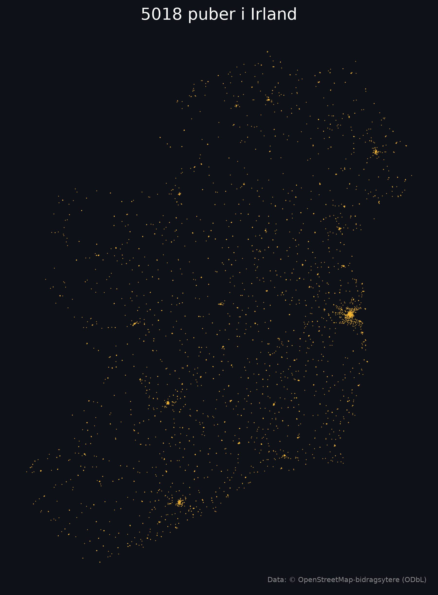

# 🍺 Pubs of Ireland – interactive map

**Live map:** https://jakobhatland-sys.github.io/irland-pubkart/



An interactive web map of every pub in Ireland and Northern Ireland, extracted from OpenStreetMap.
Built as a planning tool for a trip to Ireland in 2027: where are the pubs, what are they called, and exactly where are they.

## Features

- ~5 000 pubs rendered as glowing beer-coloured points on a dark basemap
- Click a pub → name, address, WGS84 coordinates (6 decimals), opening hours, website
- Copy coordinates to clipboard, open in OpenStreetMap or Google Maps
- Search by pub name or town
- Live count of pubs in the current map extent
- Density heatmap toggle
- Geolocation ("where am I relative to the nearest pub?") and metric scale bar
- Responsive layout for mobile use on the trip

## Data pipeline

```
OpenStreetMap ──Overpass API──▶ puber.json ──lag_geojson.py──▶ pubs.geojson ──▶ index.html (MapLibre GL JS)
```

1. **Extraction** – Overpass QL query for all `amenity=pub` objects (nodes, ways and relations) within the
   administrative areas `ISO3166-1=IE` and `ISO3166-2=GB-NIR`. Polygons (pubs mapped as buildings) are
   reduced to their centre point with `out center`.
2. **Transformation** – `lag_geojson.py` converts the raw OSM JSON to a compact GeoJSON FeatureCollection
   (EPSG:4326), keeping name, address, website and opening hours. Falls back across several Overpass
   mirrors, and to a local CSV if all servers are down.
3. **Visualisation** – `index.html` is a static single-page app using MapLibre GL JS with a CARTO Dark Matter
   vector basemap. No backend – hosted directly on GitHub Pages.

`irske_puber.py` produces the static overview map shown above (matplotlib) plus a CSV export.

## Run locally

```bash
python -m venv .venv
.venv\Scripts\activate          # Windows  (source .venv/bin/activate on macOS/Linux)
pip install requests matplotlib

python lag_geojson.py            # builds pubs.geojson (add --csv to skip Overpass and use irske_puber.csv)
python -m http.server            # open http://localhost:8000
```

To refresh the data, delete `puber.json` and run `lag_geojson.py` again.

## Limitations

- Completeness depends on OpenStreetMap. Ireland is well mapped, but some rural pubs may be missing or
  closed ones may still be tagged.
- Hotel bars and restaurants with a pub licence are only included if they are tagged `amenity=pub`.
- An authoritative cross-check for the Republic is Revenue's
  [Register of renewed liquor licences](https://data.gov.ie/en_GB/dataset/register-of-renewed-liquor-licences)
  (publican's licences) – a possible future extension.

## Tech

Python · Overpass QL · GeoJSON · MapLibre GL JS · GitHub Pages

## Credits

Map data © [OpenStreetMap contributors](https://www.openstreetmap.org/copyright), ODbL.
Basemap © [CARTO](https://carto.com/attributions).
Code: MIT licence.
